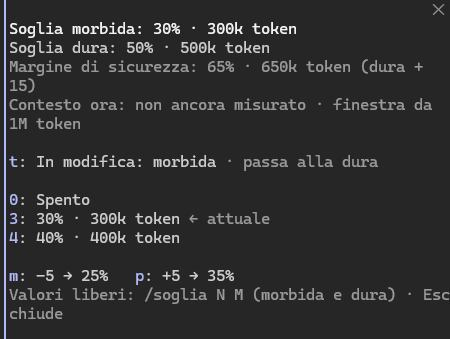

# auto-clear-context

A **Claude Code** mod that keeps long sessions going on its own: near the context thresholds Claude saves its state in a validated handoff, the mod runs `/clear` and the work resumes by itself in the clean session.

*Mod per Claude Code: vicino alle soglie di contesto Claude salva lo stato in un handoff validato, la mod esegue `/clear` e il lavoro riparte da solo nella sessione pulita.*

**[English](#english)** · **[Italiano](#italiano)**

---

## English

As a Claude Code session grows, the context window fills up and the work has to be cleared and rebuilt by hand. auto-clear-context automates that loop. When usage crosses a threshold, the mod tells Claude to write a *handoff* of the work in progress; a fresh read-only subagent rebuilds the task from that file alone and lists the gaps; once the handoff is marked validated, the mod runs `/clear` at the end of the turn, attaches the handoff to the new session and resumes from its "next step". No typing needed.

The mod nudges, it does not force: it adds a note to Claude's context once per zone, and Claude decides when to hand off by following the skill's rules. If no handoff is made, Claude Code's own auto-compact, when enabled, remains the fallback. The mod's messages, the `/soglia` panel and the skill are written in Italian (*soglia* = threshold, *morbida* = soft, *dura* = hard).

### What it contains

| Part | Role |
| --- | --- |
| Hooks module (`mod/hooks/register.tsx`) | Measures context usage, tells Claude when it enters a zone, runs `/clear` and the resume; registers the `/soglia` command and the `context_usage` tool |
| Skill `auto-clear-context:handoff` (`mod/skills/handoff/`) | Writes the session's own `.claude/handoff/pending/<session id>.md`, has it checked by the validator, marks it `status: validated` |
| Agent `auto-clear-context:handoff-validator` (`mod/agents/`) | Read-only subagent (Read, Glob, Grep): rebuilds the work from the handoff alone and checks it against a 12-point checklist (self-contained, git state, real paths, resume checks, verified facts vs assumptions, skills and tools by exact name); runs on `model: sonnet`, `effort: low` from its definition, and the mod also passes the model explicitly, so it does not inherit the lead's model |

### How it works

| Zone | Default | With a 1M-token window | What Claude is told to do |
| --- | --- | --- | --- |
| Normal | below 40% | up to 400k | keep working |
| Soft | from 40% | 400k | hand off at the next natural point: a finished, verified sub-task, or before opening a new file or feature |
| Hard | from 60% | 600k | finish the atomic action in progress and hand off at the first safe point, recording unfinished work under "Lavoro interrotto" (interrupted work) |
| Safety margin | from 75% (hard + 15) | 750k | hand off immediately, even with work half done |

Each zone is signalled at most once per session (only the highest one if usage jumps past several), either with the next prompt or mid-turn, checked after tool calls at most every 30 s. After a compact the zones re-arm, and if auto-compact fires before the clear, the session's validated handoff is attached to the compacted session with its next prompt instead. A typical cycle in the transcript (values illustrative):

```text
auto-clear-context: contesto al 41% (zona morbida, soglie 40/60/75%): la nota parte con il prossimo prompt
auto-clear-context: zona morbida segnalata a Claude insieme al prompt
auto-clear-context: handoff 9b1c4e2a1f3c della sessione 3f2a8c1d validato: eseguo /clear
auto-clear-context: clear eseguito: invio il prompt di ripresa
auto-clear-context: handoff 9b1c4e2a1f3c della sessione 3f2a8c1d allegato alla sessione (clear) e archiviato in .claude/handoff/archive/2026-10-12T10-15-00-000Z-9b1c4e2a1f3c.md
```

In order: the soft zone is reached at 41% and the note goes out with the next prompt; the handoff is validated and the mod runs `/clear`; the resume prompt is sent; the handoff is attached to the new session and archived.

**Pause handoffs.** A handoff written to stop, not to continue (PC shutdown, end of the day, a stop asked by the user) carries `mode: pausa` in its frontmatter. Since 0.11.0 the mod still validates it, runs `/clear` and archives it right away in `archive/`, but sends no resume prompt: the work stays stopped. If the session stays open, the user's first prompt gets the handoff attached, even after another `/clear` in between. Since 0.12.0 a teammate's handoff with `mode: pausa` works the same way: once validated, the mod archives it and stops the teammate with `TaskStop`, without relaunching it; the zone note tells teammates when to use it.

In the project the mod uses `.claude/handoff/`: `pending/` (one handoff per session), `archive/` and `events.log`.

### Subagents and teammates

With `agents` on (default), the context of subagents and teammates is monitored too, with zones of their own in absolute tokens, independent of the main session's thresholds (a main soft threshold of 0 still turns them off): soft at `agentSoftTokens` (120k), hard at `agentHardTokens` (150k), safety margin 30k above the hard one. Tokens, not percentages: the plugin API gives only the main session's window, not the agent's, and an agent's cost grows with the tokens per call. In a zone the agent gets a note: it first commits the files it changed, by name (never `git add -A`), or lists the uncommitted ones and why in the handoff; then it writes its own handoff, `.claude/handoff/pending/<session id>--<agent id>.md`, with `status: ready` and `agent: <id>`. The mod looks the file up by agent id, so it still finds it after a `/clear` of the main session. Since 0.9.0 the note carries the handoff template the validator expects, read at each note from the plugin's own `skills/handoff/SKILL.md` (the `## Formato` section with the agent's frontmatter, the fact-gathering step and `## Regole`) and `agents/handoff-validator.md` (the numbered checks, one immediate next step included), so an agent that never loaded the skill writes an accepted handoff on the first try; if either file cannot be read, the note falls back to naming the skill.

- **Teammates**: the mod runs the validator, stops the teammate and relaunches it with `$.agent.spawn` (same name, description, type and model) with the handoff as prompt. The host rejects the Agent tool when a plugin calls it, hence the spawn. If `TaskStop` or the spawn is denied, or the relaunched agent is not in the team (no `teammateId`), the mod asks the main session to stop and relaunch. The teammate's last line says the mod relaunches it: the lead must not tell it to resume on its own. If the handoff is deleted during validation there is no relaunch; if it is rewritten, it is validated again.
- **Subagents**: not validated by the mod. The agent checks the file itself and its final answer is `HANDOFF <path>: relaunch …`; whoever launched it relaunches with "Riprendi dall'handoff <path>". When that relaunch starts (Agent succeeded, no deny or error) the mod marks the file in `pending/` as `status: resumed` (content kept, the new agent reads it), copies it to `archive/` and logs a line. Before, these stayed `ready` forever.
- **Main session**: its `/clear` is rechecked at each agent's `turn.complete`. Idle teammates, the mod's validators and the mod's own agents do not hold it back; active agents get a pause note. After 20 minutes of waiting there is only a warning, never a forced clear; an agent the list still shows as active but with no activity seen by the mod for `agentStaleMinutes` no longer holds it back (see below).
- **Stale agents**: an agent the list still shows as active, but with no observed activity (model steps, tools, turn start/end) for `agentStaleMinutes` (default 30, `0` = off), stops holding back the main session's clear. One log line per agent; if it becomes active again it counts again. A timer rechecks the clear at expiry even if no turn ends. Why: a finished background subagent stayed "running" in the list and the clear was postponed forever.
- **Delivered agents** (since 0.13.0): a subagent that has already handed in its report (the engine marks its task `completed`, or the mod saw its turn end with no new turn after it) but is still listed as active, for example because of its own background process, gets a toast and a log line, as soon as a validated handoff's clear is waiting on it, with its name and the suggested `TaskStop <id>`. If the main clear is still waiting on it after 2 minutes and the main session is not in a turn, the mod stops it with `TaskStop` (log and toast with the agent's name) and rechecks the clear on a timer, with no new turn needed. If `TaskStop` is refused, the main session gets one prompt asking for `TaskStop <id>`. Agents still working (or resumed with a new turn) are never stopped. Why: on 19/11 a subagent that had reported held the clear for 13 minutes while the main session sat at the end of its turn.
- **Delivered agents, always** (since 0.14.0): the same rule runs without any handoff too. At every turn end (agent or main) and on a timer of its own, an agent that has delivered and is still active only for background work is warned at once (toast and log: name, id, the last command it started in the background with Bash `run_in_background` or Monitor) and stopped with `TaskStop` after `deliveredStopMinutes` (default 5, `0` = off), even while the main session is in a turn; the toast and the log name the agent, the command and the minutes, and the main session gets a note in the context of its next tool or prompt. A teammate counts as delivered only if, after a turn end, it stays `waiting` on a background command of its own (never `idle`, never during its handoff's validation). Agents that have not delivered are never stopped. With a deferred clear the 2-minute rule above still applies. Why: on 19/11 evening a subagent that had reported stayed alive for 2 hours on an `until … sed '/a\|b/'` loop that BSD sed never satisfied, with no handoff in progress.
- Relaunches have their own counter, per teammate name, with the same cap as clears (`maxClearsPerHour` per rolling hour); they do not use up the main session's clears.

### Several sessions in one folder

Each session writes its handoff to its own file, `.claude/handoff/pending/<session id>.md`, with `session: <session id>` in the frontmatter. The skill gets the id from `${CLAUDE_SESSION_ID}`, and the zone note names the same path. At the end of a turn the mod looks only at the current session's handoff, so a session never clears because another one validated its own. After a `/clear` it attaches only the handoff of the session that the clear closed. Two sessions can hand off at the same time without overwriting each other.

**Worktrees and missing handoffs** (since 0.15.0). The handoff folder is always in the main repository: the mod resolves it with `git rev-parse --path-format=absolute --git-common-dir` (cached; outside git, or on error, the session root), and every note, the `HANDOFF` line and the skill use the absolute path, so a session or agent working in a worktree writes where the mod reads. A handoff written by mistake under the agent's cwd, the session cwd or the session root is still picked up, with a log line («handoff trovato fuori dal repo principale»). After a zone note, if the file is missing or empty when the recipient ends a turn announcing `HANDOFF` (or after running the skill), or `handoffWaitSeconds` (default 180, `0` = off) after the note while the recipient is idle, the mod warns once per note: a teammate by message, a subagent (or a failed message) and the main session through a note in its next tool or prompt, with the expected path and `test -s <path>`; plus a log line («handoff atteso»). Why: on 23–24/11 three handoffs were never resumed, written in a worktree or not written at all.

A validated handoff stays in its file if its session is closed before the clear (for example while the hourly cap holds the clear back). No other session takes it over. While that session is still open, a manual `/clear` there attaches the handoff to its first prompt (without the resume prompt); otherwise resume it by hand by asking Claude to read the file. A draft left behind can only be resumed by hand.

Handoffs written by earlier versions in the shared `.claude/handoff/pending.md` are used only when their frontmatter carries `session:` with the id of the session that reads them. Without that field the file belongs to no session: none clears or resumes from it, it stays where it is, and the log says so once. Resume it by hand or delete it.

Restart open sessions after updating. A session still running the previous module reads only the shared `pending.md`, so a handoff written to the new path would not clear there.

### Install

Installation runs **from a terminal**. Installed with the `user` scope, the mod also applies to the Code tab of the desktop app on the same machine (the install command is not available there). Open new sessions after installing.

In a Claude Code terminal session:

```text
/plugin install auto-clear-context --marketplace IndjiWR/auto-clear-context
```

Answer `y` to add the marketplace and pick the `user` scope. Or from a shell:

```bash
claude plugin install auto-clear-context --marketplace IndjiWR/auto-clear-context --scope user
```

From a local clone (`git clone https://github.com/IndjiWR/auto-clear-context.git`), pass its path instead: `claude plugin install auto-clear-context --marketplace <path-to-clone> --scope user`. The plugin is then read from that folder, so don't move or delete it.

Update with `claude plugin update auto-clear-context`.

### Configuration

| Option | Default | Accepted by `/soglia` | Meaning |
| --- | --- | --- | --- |
| `threshold` | 40 | 0, or 1–85 and at least 10 below hard | soft zone (%); `0` turns the monitor off |
| `hardThreshold` | 60 | soft + 10 to 95 | hard zone (%) |
| `mainSoftTokens` | 0 | — | main session soft zone in tokens too, whichever comes first (hard `mainHardTokens`, at least +30k; margin +30k); `0` = percent only |
| `mainHardTokens` | 0 | — | main session hard zone in tokens |
| `agents` | on | — | monitor subagents and teammates too |
| `agentSoftTokens` | 120000 | — | agents' soft zone, in tokens; `0` = no zone notes to agents |
| `agentHardTokens` | 150000 | — | agents' hard zone, in tokens (margin = hard + 30000) |
| `agentStaleMinutes` | 30 | — | minutes without observed activity after which an agent no longer holds back the main clear; `0` = off |
| `blockAgentsWhileDeferred` | true | — | while the validated handoff waits for agents, a new Agent call of the main session is denied (the mod's own spawns excepted) |
| `handoffWaitSeconds` | 180 | — | seconds after a zone note after which, with the recipient idle and its handoff file missing or empty, the mod warns once; `0` = off |
| `deliveredStopMinutes` | 5 | — | minutes after which an agent that delivered but stays active (background shell or wait) is stopped with `TaskStop`, even without a handoff; `0` = off |
| `maxClearsPerHour` | 3 | — | automatic clears per rolling hour, counted across all sessions; `0` disables them; above 20 means no cap (the mod keeps only the last 20 clears) |

The safety margin is always hard + 15, capped at 95%. Only `/soglia` checks the ranges above: values set in `/config` or at install are taken as given, except that the hard threshold in force is raised to at least soft + 10 and capped at 95.

Ways to set them:

- at install time: `claude plugin install auto-clear-context --marketplace IndjiWR/auto-clear-context --config threshold=45`;
- in `/config`, where the plugin's options are listed;
- with `/soglia`: `/soglia 45` sets the soft threshold, `/soglia 45 65` soft and hard (use it to move both when the soft one would end up less than 10 below the hard one), `/soglia morbida 45` or `/soglia dura 65` one of them, `/soglia 0` (or `off`) turns the monitor off. `/soglia` alone opens a panel with presets and their token counts (terminal keys: digits for presets, `t` to switch between soft and hard, `m`/`p` for −5/+5, `Esc` to close).

Where `/config` has no rows for the plugin (headless sessions, the desktop Code tab), `/soglia` saves the values in the mod's own store. They apply at once in every session and take precedence over `/config` from then on; set the `/config` value again with `/soglia` to drop the override.



*The `/soglia` panel in a terminal session, here with soft 30% and hard 50% on a 1M-token window.*

Claude can read the current usage and zone with the mod's `context_usage` tool, which answers with one line such as `47% · zona morbida (40/60%)`. To hand off by hand, ask Claude to use the `auto-clear-context:handoff` skill.

### Safety limits

- **Only a handoff marked validated clears.** The mod runs `/clear` only when the frontmatter of the session's handoff says `status: validated`, which the skill sets after up to 2 rounds with the read-only validator. A draft never triggers a clear. The mod trusts that flag: it reads only the frontmatter, so a file marked validated by hand clears too.
- **Only for the session that wrote it.** The clear runs only in the session that wrote the handoff, and only the fresh session that follows that clear gets the handoff attached. A validated file in a session's slot whose frontmatter carries another session's id is skipped and logged.
- **One clear per handoff**, and at most `maxClearsPerHour` (default 3) per rolling hour; past that the handoff waits. The count is kept in the mod's store, so it is shared by all sessions on the machine.
- **Never with work in flight.** No clear after an interrupted turn, while the main session is in a turn, or while an agent is pending, running or waiting, except agents with no observed activity for `agentStaleMinutes` (separate-pane teammates expire too, counted from the last change of their status, label or token count in the list). The clear is rechecked when an agent ends its turn: that agent counts as stopped; idle teammates, the mod's validators and the agents it started do not hold the clear back. In every zone the skill makes Claude wait for or stop background work first. In the soft and hard zones the skill and the zone notes also rule out handing off mid-edit, mid-debug or with a question to the user pending; whatever is left unfinished in the hard zone or the safety margin goes into the handoff's interrupted-work section.
- **Bounded retry.** If `/clear` fails the mod retries once after 300 ms, then gives up and logs why. That handoff then counts as used: change it and validate it again to get a new clear.
- **Everything is visible.** Every step shows up in the transcript (`auto-clear-context: …` lines) and in `.claude/handoff/events.log` (last 300 events).
- **Kept out of git.** When the project root has a `.git` directory, the mod adds `.claude/handoff/` to `.git/info/exclude`, which is local and never committed. The skill also tells Claude to keep handoffs under 9,000 characters and free of secrets; the mod does not check either.

### Known limits

- The "Ripristina /config" (restore `/config`) button of the `/soglia` panel does not work yet in real sessions, although the test kit's version of the flow passes: set the value with `/soglia N`.
- The mod cannot see background commands (Bash, monitors); the skill makes Claude wait for them or stop them before the handoff.
- An agent `waiting` on its own background work (Bash, monitor) for longer than `agentStaleMinutes` counts as stalled, and the clear can go ahead.
- The git exclude is skipped in worktrees and submodules, where `.git` is a file.
- The mods API cannot delete files: after the resume a session's file in `.claude/handoff/pending/` stays behind empty (an empty file means nothing pending); subagent handoffs marked `status: resumed` stay too, with their content. Empty files, `resumed` files and drafts left by closed sessions pile up there and can be deleted by hand.
- Teammate auto-relaunch (0.6.0) is covered by tests but not yet verified live: `claude -p` has no `TeamCreate`, so it needs an interactive session with a team.
- No `/clear` inside an agent: it is relaunched with a clean context, and a relaunched teammate loses its original `effort`.
- Agent zones are in absolute tokens, not a share of the agent's own window (the API does not expose it); teammates in a separate pane are not monitored.
- Claude Code only (terminal and the desktop Code tab); it does not run in claude.ai chats.
- A user-tier mod does not run under the `classic.*` hooks that the managed tier skips (`next.to`, as `cc-plugin-sec-default@builtin` does in Team organizations). Since 0.8.0 the mod uses native events only: notes during the turn go on `tool.call`, the handoff attachment on the first `prompt.submit` after a clear or a compaction.
- Organization policies can block personal mods: if `/status` shows "Enterprise managed settings", ask your admin.

### Early-access mods API

Mods are in **early access**: the hooks API this module is built on (`register`, `$.session`, `$.command`, `$.ui`, `$.state`, the `claude-code/testing` kit) can change between Claude Code releases, and a new release can break the mod until it is updated. Check the versions below before relying on it.

### Tested Claude Code versions

| Version | Surface | Result |
| --- | --- | --- |
| 2.1.322 | `claude plugin test mod` (macOS) | 37 of 37 tests pass; `claude plugin validate` passes |
| 2.1.296 | `claude plugin test mod` (Windows 11) | 37 of 37 tests pass; `claude plugin validate` passes |
| 2.1.296 | terminal | manual tests in real sessions |
| 2.1.295 | desktop app, Code tab (Windows) | manual tests in real sessions |
| 2.1.212 | any | not supported: no mods API |

The one-line `/plugin install … --marketplace` form needs Claude Code 2.1.275 or later. Check your version with `claude --version` and update with `claude update`.

### How it is built

One TypeScript/TSX hooks module on the mods API:

| Event | Role |
| --- | --- |
| `session.measure`, `tool.call` | watch context usage after each turn (`session.measure` also re-arms the zones when usage falls back below the soft threshold); `tool.call` delivers the zone notes during long turns (`result.context`) |
| `session.compact` | re-arms the zones and queues the session's validated handoff for the next prompt |
| `prompt.submit` | attaches the zone note, and after a clear or a compaction the validated handoff (archived afterwards), to the next prompt |
| `turn.complete` | checks the session's own handoff, the caps and running subagents, then runs `/clear` |
| `session.end` | remembers which session the clear closed and submits the resume prompt |
| `session.start`, `command.run`, `ui.render`, `tool.call` | register and serve `/soglia`, its panel and `context_usage` (the same `tool.call` also carries the notes) |

Zone flags live in `$.state` and are written with `ifVersion`, so the two monitor channels never signal the same zone twice. A two-value threshold change parks its second write in `$.state`, so it survives the module reload that a `/config` write triggers. The tests use the official `claude-code/testing` kit and render the `/soglia` panel on both the terminal and the desktop surface.

### Development

```text
.claude-plugin/marketplace.json   marketplace entry pointing at ./mod
mod/.claude-plugin/plugin.json    manifest and userConfig options
mod/hooks/hooks.json              loads register.tsx
mod/hooks/register.tsx            the hooks module
mod/types/index.d.ts              the $.state contract
mod/skills/handoff/SKILL.md       handoff skill
mod/agents/handoff-validator.md   read-only validator agent
mod/tests/*.test.ts               tests (claude-code/testing)
mod/tsconfig.json                 extends the types the engine writes
```

Run `claude plugin validate .` (marketplace), `claude plugin validate mod` (manifest and module) and `claude plugin test mod` (tests). To try the mod from a clone without installing it, start Claude Code with `claude --plugin-dir mod`; the engine then writes the API types into `mod/.claude-plugin/types/`, which `mod/tsconfig.json` extends.

### Uninstall

```bash
claude plugin uninstall auto-clear-context
```

Any `.claude/handoff/` folders in your projects can then be deleted by hand.

---

## Italiano

Mod per **Claude Code** che gestisce da sola le conversazioni lunghe. Quando il contesto si riempie, Claude salva lo stato del lavoro in un *handoff*, un subagent lo verifica, la mod esegue `/clear` e il lavoro riparte da solo nella sessione pulita, con l'handoff allegato. Non serve scrivere niente.

### Cosa contiene

| Parte | Cosa fa |
| --- | --- |
| Mod (`mod/hooks/register.tsx`) | Misura il contesto, avvisa Claude quando entra in una zona, esegue `/clear` e la ripresa; comando `/soglia`; tool `context_usage` |
| Skill `auto-clear-context:handoff` (`mod/skills/handoff/`) | Scrive il file della sessione, `.claude/handoff/pending/<id della sessione>.md`, lo fa validare e lo segna come validato |
| Agent `auto-clear-context:handoff-validator` (`mod/agents/`) | Subagent in sola lettura: ricostruisce il lavoro dal solo handoff e lo verifica con 12 controlli (autosufficienza, stato git, percorsi reali, verifica alla ripresa, fatti separati dalle ipotesi, skill e strumenti col nome esatto); gira su `model: sonnet`, `effort: low` dalla sua definizione, e la mod passa anche il modello esplicito, così non eredita quello del lead |

### Come funziona

| Zona | Default | Con una finestra da 1M token | Cosa fa Claude |
| --- | --- | --- | --- |
| Normale | sotto il 40% | fino a 400k | lavora normalmente |
| Morbida | dal 40% | 400k | fa l'handoff al prossimo punto naturale (sotto-task finito e verificato, prima di un file o una feature nuova) |
| Dura | dal 60% | 600k | fa l'handoff al primo punto sicuro, anche con lavoro a metà (lo descrive in "Lavoro interrotto") |
| Margine di sicurezza | dal 75% (dura + 15) | 750k | fa l'handoff subito |

Nelle zone morbida e dura mai a metà di un edit o di un debug; in nessuna zona con lavoro in background attivo.

Dopo l'handoff validato, a fine turno la mod esegue `/clear`, allega l'handoff alla sessione nuova e fa ripartire il turno dal "prossimo passo".

**Più sessioni nella stessa cartella.** Ognuna scrive il suo handoff in `.claude/handoff/pending/<id della sessione>.md`, con `session: <id della sessione>` nel frontmatter. La skill prende l'id da `${CLAUDE_SESSION_ID}` e la nota di zona riporta lo stesso percorso. A fine turno la mod guarda solo l'handoff della sessione, quindi una sessione non fa mai `/clear` per l'handoff validato di un'altra; dopo il `/clear` allega solo l'handoff della sessione che il clear ha chiuso.

**Worktree e handoff mancanti** (dalla 0.15.0). La cartella degli handoff sta sempre nel repo principale: la mod la trova con `git rev-parse --path-format=absolute --git-common-dir` (in cache; fuori da git o in caso d'errore, la root della sessione), e note, riga `HANDOFF` e skill usano il percorso assoluto, così chi lavora in un worktree scrive dove la mod legge. Un handoff scritto per errore nel cwd dell'agente, nel cwd o nella root della sessione si recupera comunque, con una riga nel log («handoff trovato fuori dal repo principale»). Dopo una nota di zona, se il file manca o è vuoto quando il destinatario chiude un turno con `HANDOFF` (o dopo la skill), oppure `handoffWaitSeconds` (default 180, `0` = spento) dopo la nota con il destinatario fermo, la mod avvisa una volta per nota: il teammate con un messaggio, il subagent (o un messaggio non consegnato) e la principale con una nota al prossimo tool o prompt, con il percorso atteso e `test -s <percorso>`; più una riga nel log («handoff atteso»). Motivo: il 23–24/11 tre handoff non sono ripartiti, scritti in un worktree o mai scritti.

**Handoff di pausa.** Un handoff scritto per fermarsi e non per continuare (spegnimento del PC, chiusura notturna, stop chiesto dall'utente) porta `mode: pausa` nel frontmatter. Dalla 0.11.0 la mod lo valida, esegue `/clear` e lo archivia subito in `archive/`, ma non invia il prompt di ripresa: il lavoro resta fermo. Se la sessione resta aperta, il primo prompt dell'utente riceve l'handoff allegato, anche dopo un altro `/clear` nel mezzo. Dalla 0.12.0 vale anche per l'handoff di un teammate: validato con `mode: pausa`, la mod lo archivia e ferma il teammate con `TaskStop` senza rilanciarlo; la nota di zona spiega ai teammate quando usarlo.

Se la sessione si chiude prima del clear (per esempio mentre il limite orario lo trattiene), l'handoff validato resta nel suo file e nessun'altra sessione lo prende. Finché quella sessione è aperta, un `/clear` a mano lì allega l'handoff al primo prompt (senza il prompt di ripresa); altrimenti chiedi a Claude di leggere quel file. Una bozza rimasta lì si riprende solo a mano.

Gli handoff delle versioni precedenti, nel `.claude/handoff/pending.md` condiviso, valgono solo se il frontmatter porta `session:` con l'id della sessione che li legge. Senza quel campo il file non è di nessuna sessione: nessuna fa `/clear` né riprende da lì, il file resta dov'è e il log lo segnala una volta. Riprendilo a mano o cancellalo.

Dopo l'aggiornamento riavvia le sessioni aperte: finché usano la versione vecchia della mod leggono solo il `pending.md` condiviso, e un handoff scritto nel percorso nuovo lì non fa partire il `/clear`.

Sicurezze:
- `/clear` solo nella sessione che ha scritto l'handoff, e l'handoff va solo alla sessione pulita che la segue;
- un solo clear per handoff, al massimo 3 clear all'ora contati su tutte le sessioni (opzione `maxClearsPerHour`);
- nessun clear con la principale in un turno o con agenti ancora attivi (pending, running, waiting), salvo quelli senza attività da `agentStaleMinutes` (anche i teammate in un pannello separato scadono, dall'ultima variazione di stato, label o token nell'elenco); si ricontrolla quando un agente finisce il turno, e quell'agente conta come fermo; teammate `idle`, validatori e agenti avviati dalla mod non lo trattengono;
- ogni passaggio compare nel transcript (righe `auto-clear-context: …`) e in `.claude/handoff/events.log`.

Nel progetto la mod usa la cartella `.claude/handoff/`, con `pending/` (un handoff per sessione), `archive/` ed `events.log`. Se la root del progetto ha una cartella `.git`, la aggiunge da sola a `.git/info/exclude`, così non finisce in un commit.

### Subagent e teammate

Con `agents` attivo (default) la mod monitora anche il contesto di subagent e teammate, con zone proprie in token assoluti, indipendenti dalle soglie della principale (con la morbida della principale a 0 si spengono comunque): morbida a `agentSoftTokens` (120k), dura a `agentHardTokens` (150k), margine di sicurezza 30k sopra la dura. Token e non percentuali: l'API dei plugin dà solo la finestra della principale, non quella dell'agente, e il costo di un agente cresce con i token per chiamata. In zona l'agente riceve una nota: prima committa i file che ha modificato, per nome (mai `git add -A`), o elenca nell'handoff quelli non committati e il motivo; poi scrive il suo handoff, `.claude/handoff/pending/<id sessione>--<id agente>.md`, con `status: ready` e `agent: <id>`. La mod cerca il file per id dell'agente, quindi lo trova anche dopo un `/clear` della principale. Dalla 0.9.0 la nota porta il modello d'handoff richiesto dal validatore, letto a ogni nota dai file del plugin `skills/handoff/SKILL.md` (sezione `## Formato` col frontmatter da agente, il passo «Raccogli i fatti» e `## Regole`) e `agents/handoff-validator.md` (i punti numerati, fra cui un solo prossimo passo): un agente che non ha caricato la skill scrive un handoff accettato al primo giro; se uno dei due file non si legge, la nota rimanda alla skill.

- **Teammate**: la mod lancia il validatore, ferma il teammate e lo rilancia con `$.agent.spawn` (stesso nome, descrizione, tipo e modello) con l'handoff come prompt. L'host rifiuta il tool Agent chiamato da un plugin, da qui lo spawn. Se `TaskStop` o lo spawn vengono negati, o il rilanciato non è nel team (nessun `teammateId`), la mod chiede alla sessione principale di fare stop e rilancio. L'ultima riga del teammate dice che lo rilancia la mod: il lead non deve farlo riprendere da solo. Se l'handoff viene cancellato durante la validazione il rilancio salta; se viene riscritto, si valida di nuovo.
- **Subagent**: la mod non li valida. L'agente controlla il file da solo e risponde `HANDOFF <percorso>: rilancia …`; lo rilancia chi lo ha lanciato con «Riprendi dall'handoff <percorso>». Quando quel rilancio parte (Agent riuscito, senza deny né errore) la mod segna il file in `pending/` con `status: resumed` (il contenuto resta, perché il nuovo agente lo legge), ne mette una copia in `archive/` e scrive una riga nel log. Prima restavano `ready` per sempre.
- **Sessione principale**: il suo `/clear` si ricontrolla al `turn.complete` di ogni agente. Teammate `idle`, validatori e agenti della mod non lo bloccano; gli agenti attivi ricevono una nota di pausa. Dopo 20 minuti di rinvio c'è solo un avviso, mai un clear forzato; un agente che l'elenco dà ancora attivo ma senza attività osservata dalla mod da `agentStaleMinutes` non lo blocca più (vedi sotto).
- **Agenti stantii**: un agente che l'elenco dà ancora attivo, ma senza attività osservata (passi del modello, tool, inizio/fine turno) da `agentStaleMinutes` minuti (default 30, `0` = spenta), non trattiene più il clear della principale. Una riga nel log per agente; se torna attivo conta di nuovo. Un timer ricontrolla il clear alla scadenza anche se nessun turno finisce. Col clear rimandato un nuovo Agent della principale è negato (`blockAgentsWhileDeferred`, default acceso); un handoff riscritto ma ancora validato non azzera il conto dei 20 minuti. Motivo: un subagent in background già finito restava "running" nell'elenco e il clear era rimandato senza fine.
- **Agenti che hanno consegnato** (dalla 0.13.0): un subagent che ha già dato il report (il motore segna il suo task `completed`, o la mod ha visto la sua fine turno senza un nuovo inizio) ma che l'elenco dà ancora attivo, per esempio per un suo processo in background, fa partire un toast e una riga nel log, appena il clear di un handoff validato lo aspetta, con il nome e il comando suggerito `TaskStop <id>`. Se dopo 2 minuti trattiene ancora il clear e la principale non è in un turno, la mod lo ferma con `TaskStop` (log e toast con il nome dell'agente) e ricontrolla il clear a tempo, senza bisogno di un nuovo turno. Se `TaskStop` è rifiutato, la principale riceve una sola richiesta di fare `TaskStop <id>`. Gli agenti ancora al lavoro (o ripresi con un nuovo turno) non vengono mai fermati. Motivo: il 19/11 un subagent che aveva consegnato ha trattenuto il clear per 13 minuti con la principale ferma a fine turno.
- **Agenti consegnati, sempre** (dalla 0.14.0): la stessa regola vale anche senza handoff. A ogni fine turno (agente o principale) e con un timer suo, un agente che ha consegnato e resta attivo solo per un lavoro in background riceve subito un avviso (toast e log: nome, id, ultimo comando lanciato in background con Bash `run_in_background` o Monitor) e viene fermato con `TaskStop` dopo `deliveredStopMinutes` (default 5, `0` = spento), anche con la principale in un turno; toast e log riportano agente, comando e minuti, e la principale riceve una nota nel context del suo prossimo tool o prompt. Un teammate conta come consegnato solo se, dopo una fine turno, resta `waiting` su un suo comando in background (mai `idle`, mai durante la validazione del suo handoff). Gli agenti che non hanno consegnato non si fermano mai. Con un clear rimandato resta la regola dei 2 minuti. Motivo: il 19/11 sera un subagent che aveva consegnato è rimasto vivo 2 ore su un ciclo `until … sed '/a\|b/'` che il sed BSD non soddisfaceva mai, senza handoff in corso.
- I rilanci hanno un contatore loro, per nome del teammate, con lo stesso tetto dei clear (`maxClearsPerHour` in un'ora); non consumano i clear della principale.

### Requisiti

- **Solo Claude Code**: terminale e tab Code dell'app desktop. Non funziona nelle chat di claude.ai.
- **Claude Code recente.** Provata su 2.1.295 (tab Code dell'app desktop, Windows) 2.1.296 (terminale) e 2.1.322 (test su macOS); la 2.1.212 non supporta le mods. Controlla con `claude --version` (aggiorna con `claude update`) o con `/status`.
- **Early access.** Le mods sono in early access e l'API può cambiare tra una versione e l'altra.
- **Account aziendali.** Le policy dell'organizzazione possono bloccare le mod personali. Se `/status` mostra "Enterprise managed settings", chiedi all'admin.

### Installazione

L'installazione si fa **dal terminale**. Installata con scope `user`, la mod vale anche per il tab Code dell'app sulla stessa macchina (lì il comando di installazione non è disponibile). Dopo l'installazione apri sessioni nuove.

#### Da GitHub

In una sessione di Claude Code nel terminale:

```text
/plugin install auto-clear-context --marketplace IndjiWR/auto-clear-context
```

Rispondi `y` per aggiungere il marketplace e scegli lo scope `user`. In alternativa, da una shell:

```bash
claude plugin install auto-clear-context --marketplace IndjiWR/auto-clear-context --scope user
```

Per aggiornare a una nuova versione:

```bash
claude plugin update auto-clear-context
```

#### Da un clone locale

```bash
git clone https://github.com/IndjiWR/auto-clear-context.git
```

```bash
claude plugin install auto-clear-context --marketplace <percorso-del-clone> --scope user
```

Il plugin viene letto da quella cartella: non spostarla e non cancellarla.

### Uso

- **Automatico.** Non serve fare niente: le righe `auto-clear-context: …` mostrano i passaggi.
- **`/soglia`** apre un pannello per scegliere le soglie, ognuna con i token corrispondenti. In alternativa:
  - `/soglia 45` imposta la morbida;
  - `/soglia 45 65` imposta morbida e dura;
  - `/soglia 0` spegne il monitor.
- **Soglie in token per la principale** (da `/config` o dalle settings del progetto): `mainSoftTokens` e `mainHardTokens` (default 0, spente) aggiungono soglie assolute; per ogni zona vale quella che arriva prima fra percentuale e token (dura almeno morbida + 30k, margine 30k sopra la dura). Utile con finestre da 1M, dove il 40% scatta a 400k.
- **Handoff a mano.** Chiedi a Claude: "usa la skill auto-clear-context:handoff".
- **Contesto attuale.** Claude può controllarlo con il tool `context_usage` della mod.


### Limiti noti

- Il pulsante "Ripristina /config" del pannello `/soglia` non funziona ancora: imposta il valore con `/soglia N`.
- I comandi in background (Bash, monitor) la mod non li vede: la skill fa aspettare o fermare Claude prima dell'handoff.
- Il rilancio automatico dei teammate (0.6.0) è coperto dai test ma non ancora collaudato dal vivo: con `claude -p` `TeamCreate` non c'è, serve una sessione interattiva con un team.
- Nessun `/clear` dentro un agente: viene rilanciato a contesto pulito, e il teammate rilanciato perde l'`effort` originale.
- Le zone degli agenti sono in token assoluti, non in quota della finestra dell'agente (l'API non la dà); i teammate in un pannello separato sono esclusi.
- Un agente in attesa (`waiting`) di un suo lavoro in background (Bash, monitor) per più di `agentStaleMinutes` conta come fermo e il clear può partire.
- Una mod del tier user non gira sotto i hook `classic.*` che il tier gestito salta (`next.to`, come fa `cc-plugin-sec-default@builtin` nelle organizzazioni Team). Dalla 0.8.0 la mod usa solo eventi nativi: le note durante il turno stanno su `tool.call`, l'allegato dell'handoff sul primo `prompt.submit` dopo un clear o un compact.
- Nei worktree e nei submodule, dove `.git` è un file, l'esclusione da git non viene aggiunta.
- L'API delle mod non cancella file: dopo la ripresa il file della sessione in `.claude/handoff/pending/` resta vuoto (vuoto vuol dire nessun handoff in attesa). Restano anche i file `status: resumed` dei subagent, con il loro contenuto. I file vuoti, quelli `resumed` e le bozze delle sessioni chiuse si accumulano lì e si possono cancellare a mano.

### Sviluppo

```bash
claude plugin validate .
```

```bash
claude plugin test mod
```

Il primo comando controlla il marketplace, `claude plugin validate mod` il manifest e il modulo; il secondo esegue i test in `mod/tests/` con il kit `claude-code/testing`. Per provare la mod da questa cartella senza installarla: `claude --plugin-dir mod`.

### Disinstallazione

```bash
claude plugin uninstall auto-clear-context
```

Le cartelle `.claude/handoff/` nei progetti si possono cancellare a mano.

---

## License / Licenza

[MIT](LICENSE)
